# Sequence diagrams of the tests in `rpc/tests/test_musigd.rs`

This file shows what every test of `rpc/tests/test_musigd.rs` does, as one UML sequence diagram
per test. The diagrams follow the test code of 2026-11-20.

This file is generated. Do not edit it by hand: when a test changes, change its description in
`rpc/test-musigd-sequence-diagrams.py` and run that script again.

The tests start real `musigd` processes and use only their gRPC interface. In the tests of a
whole trade, the test plays the role of bisq2 for both traders: it calls the services of each
trader's `musigd` and carries the messages of the trade protocol from one trader to the other.

## How to view the diagrams

The diagrams are written in [Mermaid](https://mermaid.js.org) (open source, MIT licence), inside
this Markdown file. Mermaid was chosen because a reader needs no extra program in most cases:

| Where | What to do |
|---|---|
| GitHub | Nothing. GitHub draws Mermaid diagrams in Markdown files. |
| IntelliJ IDEA and other JetBrains IDEs | Install the plugin "Mermaid" (by JetBrains). The Markdown preview then draws the diagrams. |
| Visual Studio Code | Open the Markdown preview. If it shows the text of a diagram instead of a drawing, install the extension "Markdown Preview Mermaid Support". |
| Any browser | Copy the text of one diagram into the Mermaid Live Editor, <https://mermaid.live>. It can also save the diagram as SVG or PNG. |
| Command line | `npx -p @mermaid-js/mermaid-cli mmdc -i rpc/test-musigd-sequence-diagrams.md -o diagrams.svg` writes one SVG file per diagram (`diagrams-1.svg`, `diagrams-2.svg`, ...). |

The alternative PlantUML has more UML elements, but it needs Java and a plugin or a server to
draw a diagram, and GitHub does not draw it.

## How to read the diagrams

Lifelines:

| Lifeline | Meaning |
|---|---|
| Buyer's bisq2 (test), Seller's bisq2 (test) | The test, in the role of the bisq2 application of this trader |
| Buyer's musigd, Seller's musigd | The `musigd` process of this trader, with its wallet |
| bitcoind (regtest) | The Bitcoin node of the test environment. A `musigd` reaches it only over the peer-to-peer network, with compact block filters. |

Arrows:

| Arrow | Meaning |
|---|---|
| bisq2 to musigd, solid | A gRPC request. `Trade.` is the trade service `musigrpc.Musig`, `Wallet.` is the wallet service `wallet.Wallet`, `Daemon.` is the internal service `musigd.internal.Daemon`. |
| musigd to bisq2, dashed | The response, or an event of a stream |
| musigd to bisq2, dashed with a cross | The request is refused with this gRPC status |
| bisq2 to bisq2, solid | A message between the traders (A to G, see `rpc/musig-trade-protocol-messages.txt`). In the test no network carries it: the test passes the data of one response into the next request. |
| bisq2 to bisq2, solid with a cross | A message that the test does not deliver |
| musigd to bitcoind, "P2P" | A transaction that `musigd` sends to the node over the peer-to-peer network |

Notes:

- "State: ..." is the state of the trade of this trader after the step. "(checked)" means that the
  test reads this state from the service and asserts it. A state without this mark follows from
  `docs/specifications/trade/trade-states.md` and the engine code; the test does not read it at
  this point.
- "Part: ..." starts a part of the test.
- A note on bitcoind describes what the test does with the node through its RPC interface: it
  mines blocks and pays coins. No `musigd` uses this interface.
- A note on a `musigd` describes a start or an end of the process, or something that `musigd` does
  on its own, without a request.

Every stream request (`PublishDepositTx`, `SubscribeTxConfirmationStatus`,
`SubscribeTradeEvents`) is drawn once. The events that the test reads from the stream follow as
dashed arrows. A request that the test repeats until `musigd` accepts it is drawn as a loop:
directly after a start, `musigd` refuses a request that needs the chain until it has evaluated
the blocks that it missed.

Values that all tests of a trade use:

| Value | Amount |
|---|---|
| Funding of each wallet | 100,000,000 sat (1 BTC) |
| Trade amount | 5,000,000 sat |
| Buyer's security deposit | 1,000,000 sat |
| Seller's security deposit | 1,200,000 sat |
| Deposit fee rate and prepared fee rate | 2,500 sat per 1000 weight units (10 sat per vbyte) |
| Warning lock time, claim lock time | 20 blocks, 10 blocks |
| Trade ID | `trade-1` |

The buyer is the taker and the seller is the maker in every trade.

## Tests

| No. | Test | Diagram shows |
|---|---|---|
| 1 | [`musigd_serves_trade_service_and_wallet_service`](#1-musigd_serves_trade_service_and_wallet_service) | Both services of one `musigd`; no trade without an open wallet |
| 2 | [`musigd_does_not_start_with_a_lock_time_outside_the_limits`](#2-musigd_does_not_start_with_a_lock_time_outside_the_limits) | Start of `musigd` with invalid lock times |
| 3 | [`j11_trade_of_two_daemons_without_bitcoin_core_rpc`](#3-j11_trade_of_two_daemons_without_bitcoin_core_rpc) | Whole trade with a cooperative close and a drain |
| 4 | [`c4_forced_close_of_two_daemons`](#4-c4_forced_close_of_two_daemons) | Forced close: swap transaction of the seller's `musigd` |
| 5 | [`h2_h5_restart_of_two_daemons_during_a_forced_close`](#5-h2_h5_restart_of_two_daemons_during_a_forced_close) | Forced close with restarts |
| 6 | [`h2_h5_restart_of_two_daemons_in_the_dispute_path`](#6-h2_h5_restart_of_two_daemons_in_the_dispute_path) | Warning and redirect, with restarts |
| 7 | [`h2_h5_m6_restart_of_two_daemons_before_a_claim`](#7-h2_h5_m6_restart_of_two_daemons_before_a_claim) | Warning and claim, with a restart |
| 8 | [`h2_h5_restart_of_two_daemons_during_a_custom_payout`](#8-h2_h5_restart_of_two_daemons_during_a_custom_payout) | Custom payout, with restarts |
| 9 | [`a3_h2_deposit_abort_of_two_daemons_after_a_restart`](#9-a3_h2_deposit_abort_of_two_daemons_after_a_restart) | Deposit abort after the deposit timeout |
| 10 | [`h3_h4_h8_daemon_is_ended_while_it_processes_a_request`](#10-h3_h4_h8_daemon_is_ended_while_it_processes_a_request) | End of `musigd` during a request |
| 11 | [`musigd_shuts_down_on_request_and_completes_the_running_request`](#11-musigd_shuts_down_on_request_and_completes_the_running_request) | Regular shutdown by request, during another request |
| 12 | [`musigd_ends_an_open_subscription_when_it_shuts_down`](#12-musigd_ends_an_open_subscription_when_it_shuts_down) | Regular shutdown with an open subscription |
| 13 | [`musigd_shuts_down_at_the_limit_while_a_request_is_open`](#13-musigd_shuts_down_at_the_limit_while_a_request_is_open) | Regular shutdown with a request that is never completed |
| 14 | [`musigd_shuts_down_on_a_termination_signal`](#14-musigd_shuts_down_on_a_termination_signal) | Regular shutdown by a signal |

## 1. `musigd_serves_trade_service_and_wallet_service`

One `musigd` without a peer serves both services. The trade service refuses to create a trade while
no wallet is open, and creates it after the wallet was created.

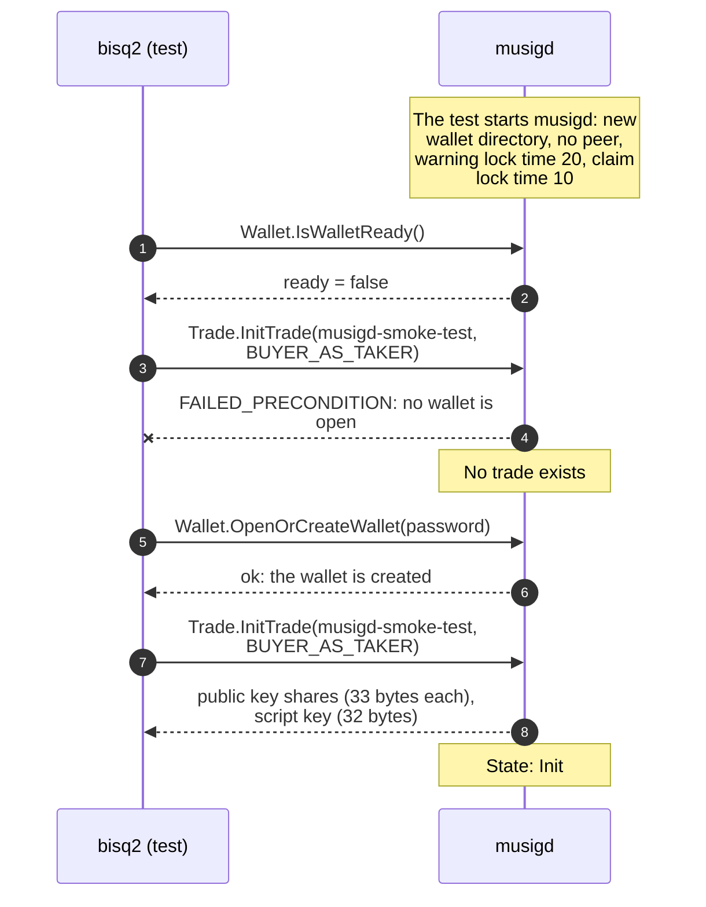

## 2. `musigd_does_not_start_with_a_lock_time_outside_the_limits`

`musigd` reads the lock times from the environment. With a value outside the limits, or with a value
that is no number, the process reports the value and ends before it serves a request. The test makes
no API call, so the diagram shows only the three starts.

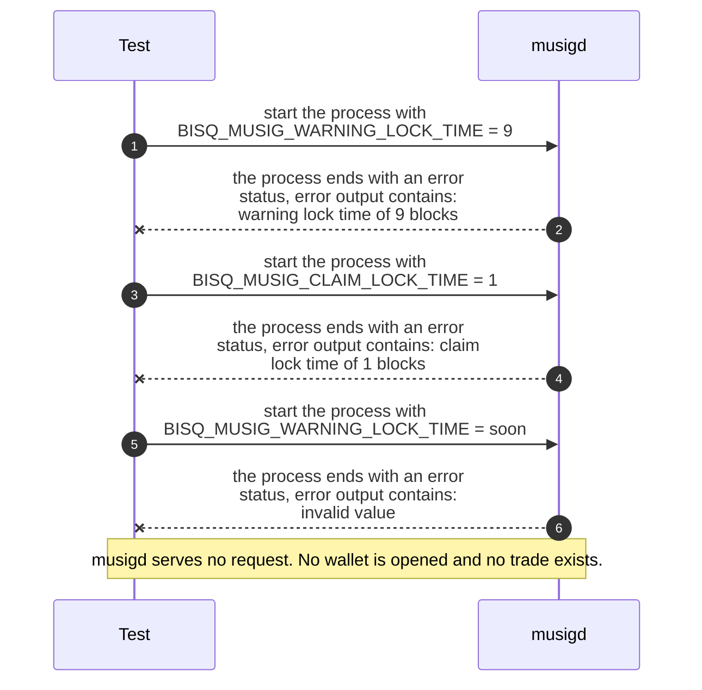

## 3. `j11_trade_of_two_daemons_without_bitcoin_core_rpc`

The complete trade without a problem (test IDs J11, A1, B1, M1): setup, deposit transaction over the
peer-to-peer network, confirmations reported to both traders, cooperative close with the messages E,
F and G, payouts in both wallets, and the drain of the buyer's payout at `Wallet.Close`.

```mermaid
sequenceDiagram
    autonumber
    participant BD as Buyer's musigd
    participant B as Buyer's bisq2 (test)
    participant S as Seller's bisq2 (test)
    participant SD as Seller's musigd
    participant N as bitcoind (regtest)
    Note over BD,N: Part: start and funding
    Note over N: The test starts bitcoind and<br/>mines 101 blocks
    Note over BD: The test starts musigd: new<br/>wallet directory, peer =<br/>bitcoind, warning lock time<br/>20, claim lock time 10
    B->>BD: Wallet.OpenOrCreateWallet(password)
    BD-->>B: ok
    Note over SD: The test starts musigd: new<br/>wallet directory, peer =<br/>bitcoind, warning lock time<br/>20, claim lock time 10
    S->>SD: Wallet.OpenOrCreateWallet(password)
    SD-->>S: ok
    B->>BD: Wallet.GetUnusedAddress()
    BD-->>B: address
    Note over N: The test pays 1 BTC to this<br/>address (RPC)
    S->>SD: Wallet.GetUnusedAddress()
    SD-->>S: address
    Note over N: The test pays 1 BTC to this<br/>address (RPC)
    Note over N: The test mines 1 block
    loop until the balance is 1 BTC
        B->>BD: Wallet.GetBalance()
        BD-->>B: balance
    end
    loop until the balance is 1 BTC
        S->>SD: Wallet.GetBalance()
        SD-->>S: balance
    end
    Note over BD,N: Part: setup of the trade trade-1, messages A to D
    B->>BD: Trade.InitTrade(trade-1,<br/>BUYER_AS_TAKER)
    BD-->>B: buyer's public key shares, script<br/>key
    Note over BD: State: Init
    S->>SD: Trade.InitTrade(trade-1,<br/>SELLER_AS_MAKER)
    SD-->>S: seller's public key shares, script<br/>key
    Note over SD: State: Init
    B->>S: Message A: buyer's public key<br/>shares, script key
    S->>SD: Trade.GetNonceShares(buyer's keys,<br/>trade parameters)
    SD-->>S: seller's half deposit, addresses,<br/>nonces, redirection amount
    S->>B: Message B: seller's public key<br/>shares, script key, half deposit,<br/>addresses, nonces
    B->>BD: Trade.GetNonceShares(seller's keys,<br/>trade parameters)
    BD-->>B: buyer's half deposit, addresses,<br/>nonces, redirection amount
    B->>BD: Wallet.GetBalance()
    BD-->>B: 0: the coins of the deposit are<br/>reserved
    S->>SD: Wallet.GetBalance()
    SD-->>S: 0: the coins of the deposit are<br/>reserved
    Note over B,S: The test builds one redirection receiver: a new address of bitcoind (RPC) gets the whole<br/>redirection amount
    B->>BD: Trade.GetPartialSignatures(seller's<br/>half deposit, addresses, nonces,<br/>redirection receivers,<br/>buyerReadyToRelease = false)
    BD-->>B: buyer's partial signatures, IDs of<br/>the 5 transactions
    B->>S: Message C: buyer's half deposit,<br/>addresses, nonces, partial<br/>signatures
    S->>SD: Trade.GetPartialSignatures(buyer's<br/>half deposit, addresses, nonces,<br/>redirection receivers,<br/>buyerReadyToRelease = false)
    SD-->>S: seller's partial signatures, IDs of<br/>the 5 transactions
    S->>SD: Trade.SignDepositTx(buyer's partial<br/>signatures)
    SD-->>S: deposit PSBT with the seller's<br/>signatures
    Note over SD: State: Deposit
    S->>B: Message D: seller's partial<br/>signatures, deposit PSBT with the<br/>seller's signatures
    B->>BD: Trade.SignDepositTx(seller's partial<br/>signatures)
    BD-->>B: deposit PSBT with the buyer's<br/>signatures
    Note over BD: State: Deposit
    Note over BD,N: Part: deposit transaction
    S->>SD: Trade.SubscribeTxConfirmationStatus(trade-1)
    B->>BD: Trade.PublishDepositTx(seller's<br/>deposit PSBT)
    BD->>N: P2P: deposit transaction
    loop until the first event arrives
        Note over N: The test mines 1 block
    end
    BD-->>B: TxConfirmationStatus(transaction,<br/>height, 1 confirmation)
    Note over N: The test mines 2 blocks
    loop until the stream ends, at 3 confirmations
        BD-->>B: TxConfirmationStatus(numConfirmations)
    end
    loop until the stream ends, at 3 confirmations
        SD-->>S: TxConfirmationStatus(transaction<br/>from the block, numConfirmations)
    end
    Note over BD,SD: State of both trades: Deposit. The deposit transaction has 3 confirmations.
    Note over BD,N: Part: payment started and release, messages E and F
    B->>BD: Trade.GetPartialSignatures(buyerReadyToRelease<br/>= true)
    BD-->>B: buyer's partial signature for the<br/>swap transaction
    Note over BD: State: BuyerReadyToRelease
    B->>S: Message E: buyer's partial signature<br/>for the swap transaction
    S->>SD: Trade.SignSwapTx(buyer's partial<br/>signature, sellerReadyToRelease =<br/>false)
    SD-->>S: response without a key share
    Note over SD: State: BuyerReadyToRelease
    S->>SD: Trade.SignSwapTx(no signature,<br/>sellerReadyToRelease = true)
    SD-->>S: seller's secret key share for the<br/>buyer's payout
    Note over SD: State: SellerReadyToRelease
    S->>B: Message F: seller's secret key share<br/>for the buyer's payout
    Note over BD,N: Part: cooperative close, message G
    B->>BD: Trade.CloseTrade(seller's secret key<br/>share)
    BD-->>B: buyer's secret key share for the<br/>seller's payout
    Note over BD: State:<br/>TradeClosed(Cooperative)
    B->>S: Message G: buyer's secret key share<br/>for the seller's payout
    S->>SD: Trade.CloseTrade(buyer's secret key<br/>share)
    SD-->>S: response without a key share
    Note over SD: State:<br/>TradeClosed(Cooperative)
    Note over BD,N: Part: payouts in the wallets
    loop until the balance is 1 BTC + trade amount, less fees
        B->>BD: Wallet.GetBalance()
        BD-->>B: balance
    end
    loop until the balance is 1 BTC - trade amount, less fees
        S->>SD: Wallet.GetBalance()
        SD-->>S: balance
    end
    Note over BD,N: Part: drain of the buyer's payout
    B->>BD: Wallet.Close()
    BD->>N: P2P: drain transaction
    BD-->>B: drainTxId
    loop until the balance is lower by the fee of the drain transaction only
        Note over N: The test mines 1 block
        B->>BD: Wallet.GetBalance()
        BD-->>B: balance
    end
```

## 4. `c4_forced_close_of_two_daemons`

The seller releases and the buyer does not answer (test IDs C1, C2, C4). The seller's `musigd`
publishes the swap transaction on its own before the buyer's warning transaction becomes valid. The
buyer's `musigd` reads the seller's key share from the confirmed swap transaction and closes the
trade. No request asks for either step.

```mermaid
sequenceDiagram
    autonumber
    participant BD as Buyer's musigd
    participant B as Buyer's bisq2 (test)
    participant S as Seller's bisq2 (test)
    participant SD as Seller's musigd
    participant N as bitcoind (regtest)
    Note over BD,N: Part: start and funding
    Note over N: The test starts bitcoind and<br/>mines 101 blocks
    Note over BD: The test starts musigd: new<br/>wallet directory, peer =<br/>bitcoind, warning lock time<br/>20, claim lock time 10
    B->>BD: Wallet.OpenOrCreateWallet(password)
    BD-->>B: ok
    Note over SD: The test starts musigd: new<br/>wallet directory, peer =<br/>bitcoind, warning lock time<br/>20, claim lock time 10
    S->>SD: Wallet.OpenOrCreateWallet(password)
    SD-->>S: ok
    B->>BD: Wallet.GetUnusedAddress()
    BD-->>B: address
    Note over N: The test pays 1 BTC to this<br/>address (RPC)
    S->>SD: Wallet.GetUnusedAddress()
    SD-->>S: address
    Note over N: The test pays 1 BTC to this<br/>address (RPC)
    Note over N: The test mines 1 block
    loop until the balance is 1 BTC
        B->>BD: Wallet.GetBalance()
        BD-->>B: balance
    end
    loop until the balance is 1 BTC
        S->>SD: Wallet.GetBalance()
        SD-->>S: balance
    end
    Note over BD,N: Part: setup of the trade trade-1, messages A to D
    B->>BD: Trade.InitTrade(trade-1,<br/>BUYER_AS_TAKER)
    BD-->>B: buyer's public key shares, script<br/>key
    Note over BD: State: Init
    S->>SD: Trade.InitTrade(trade-1,<br/>SELLER_AS_MAKER)
    SD-->>S: seller's public key shares, script<br/>key
    Note over SD: State: Init
    B->>S: Message A: buyer's public key<br/>shares, script key
    S->>SD: Trade.GetNonceShares(buyer's keys,<br/>trade parameters)
    SD-->>S: seller's half deposit, addresses,<br/>nonces, redirection amount
    S->>B: Message B: seller's public key<br/>shares, script key, half deposit,<br/>addresses, nonces
    B->>BD: Trade.GetNonceShares(seller's keys,<br/>trade parameters)
    BD-->>B: buyer's half deposit, addresses,<br/>nonces, redirection amount
    B->>BD: Wallet.GetBalance()
    BD-->>B: 0: the coins of the deposit are<br/>reserved
    S->>SD: Wallet.GetBalance()
    SD-->>S: 0: the coins of the deposit are<br/>reserved
    Note over B,S: The test builds one redirection receiver: a new address of bitcoind (RPC) gets the whole<br/>redirection amount
    B->>BD: Trade.GetPartialSignatures(seller's<br/>half deposit, addresses, nonces,<br/>redirection receivers,<br/>buyerReadyToRelease = false)
    BD-->>B: buyer's partial signatures, IDs of<br/>the 5 transactions
    B->>S: Message C: buyer's half deposit,<br/>addresses, nonces, partial<br/>signatures
    S->>SD: Trade.GetPartialSignatures(buyer's<br/>half deposit, addresses, nonces,<br/>redirection receivers,<br/>buyerReadyToRelease = false)
    SD-->>S: seller's partial signatures, IDs of<br/>the 5 transactions
    S->>SD: Trade.SignDepositTx(buyer's partial<br/>signatures)
    SD-->>S: deposit PSBT with the seller's<br/>signatures
    Note over SD: State: Deposit
    S->>B: Message D: seller's partial<br/>signatures, deposit PSBT with the<br/>seller's signatures
    B->>BD: Trade.SignDepositTx(seller's partial<br/>signatures)
    BD-->>B: deposit PSBT with the buyer's<br/>signatures
    Note over BD: State: Deposit
    Note over BD,N: Part: deposit transaction
    B->>BD: Trade.PublishDepositTx(seller's<br/>deposit PSBT)
    BD->>N: P2P: deposit transaction
    loop until the stream ends, at 3 confirmations
        Note over N: The test mines 1 block
        BD-->>B: TxConfirmationStatus(numConfirmations)
    end
    Note over BD,SD: State of both trades: Deposit. The deposit transaction has 3 confirmations.
    Note over BD,N: Part: payment started and release, messages E and F
    B->>BD: Trade.GetPartialSignatures(buyerReadyToRelease<br/>= true)
    BD-->>B: buyer's partial signature for the<br/>swap transaction
    Note over BD: State: BuyerReadyToRelease
    B->>S: Message E: buyer's partial signature<br/>for the swap transaction
    S->>SD: Trade.SignSwapTx(buyer's partial<br/>signature, sellerReadyToRelease =<br/>false)
    SD-->>S: response without a key share
    Note over SD: State: BuyerReadyToRelease
    S->>SD: Trade.SignSwapTx(no signature,<br/>sellerReadyToRelease = true)
    SD-->>S: seller's secret key share for the<br/>buyer's payout
    Note over SD: State: SellerReadyToRelease
    S-xB: Message F is not delivered: the<br/>buyer does not answer
    Note over BD,N: Part: forced close by the seller's musigd
    B->>BD: Trade.SubscribeTradeEvents(trade-1)
    BD-->>B: first event: STATE
    S->>SD: Trade.SubscribeTradeEvents(trade-1)
    SD-->>S: first event: STATE
    loop until the seller's stream reports TX_SENT
        Note over N: The test mines 1 block
        opt the deposit has 14 confirmations
            Note over SD: 6 blocks before the buyer's<br/>warning becomes valid: musigd<br/>closes by force on its own
            SD->>N: P2P: swap transaction
            SD-->>S: event: TX_SENT, SWAP_TX, state<br/>TRADE_CLOSED, FORCED
        end
    end
    Note over SD: State: TradeClosed(Forced)<br/>(checked)
    loop until the buyer's stream reports STATE TRADE_CLOSED
        Note over N: The test mines 1 block
        opt the swap transaction is confirmed
            Note over BD: musigd reads the seller's key<br/>share from the swap<br/>transaction and imports the<br/>payout
            BD-->>B: event: STATE, TRADE_CLOSED, FORCED
        end
    end
    Note over BD: State: TradeClosed(Forced)<br/>(checked)
    Note over BD,N: Part: payouts in the wallets
    loop until the balance is 1 BTC + trade amount, less fees
        B->>BD: Wallet.GetBalance()
        BD-->>B: balance
    end
    loop until the balance is 1 BTC - trade amount, less fees
        S->>SD: Wallet.GetBalance()
        SD-->>S: balance
    end
```

## 5. `h2_h5_restart_of_two_daemons_during_a_forced_close`

As the test before, with restarts (test IDs H2, H3, H5, K2). Both daemons are ended and started
after the release, and report the states in which they were ended. The buyer's `musigd` does not run
while the swap transaction is confirmed, and closes the trade after its start.

```mermaid
sequenceDiagram
    autonumber
    participant BD as Buyer's musigd
    participant B as Buyer's bisq2 (test)
    participant S as Seller's bisq2 (test)
    participant SD as Seller's musigd
    participant N as bitcoind (regtest)
    Note over BD,N: Part: start and funding
    Note over N: The test starts bitcoind and<br/>mines 101 blocks
    Note over BD: The test starts musigd: new<br/>wallet directory, peer =<br/>bitcoind, warning lock time<br/>20, claim lock time 10
    B->>BD: Wallet.OpenOrCreateWallet(password)
    BD-->>B: ok
    Note over SD: The test starts musigd: new<br/>wallet directory, peer =<br/>bitcoind, warning lock time<br/>20, claim lock time 10
    S->>SD: Wallet.OpenOrCreateWallet(password)
    SD-->>S: ok
    B->>BD: Wallet.GetUnusedAddress()
    BD-->>B: address
    Note over N: The test pays 1 BTC to this<br/>address (RPC)
    S->>SD: Wallet.GetUnusedAddress()
    SD-->>S: address
    Note over N: The test pays 1 BTC to this<br/>address (RPC)
    Note over N: The test mines 1 block
    loop until the balance is 1 BTC
        B->>BD: Wallet.GetBalance()
        BD-->>B: balance
    end
    loop until the balance is 1 BTC
        S->>SD: Wallet.GetBalance()
        SD-->>S: balance
    end
    Note over BD,N: Part: setup of the trade trade-1, messages A to D
    B->>BD: Trade.InitTrade(trade-1,<br/>BUYER_AS_TAKER)
    BD-->>B: buyer's public key shares, script<br/>key
    Note over BD: State: Init
    S->>SD: Trade.InitTrade(trade-1,<br/>SELLER_AS_MAKER)
    SD-->>S: seller's public key shares, script<br/>key
    Note over SD: State: Init
    B->>S: Message A: buyer's public key<br/>shares, script key
    S->>SD: Trade.GetNonceShares(buyer's keys,<br/>trade parameters)
    SD-->>S: seller's half deposit, addresses,<br/>nonces, redirection amount
    S->>B: Message B: seller's public key<br/>shares, script key, half deposit,<br/>addresses, nonces
    B->>BD: Trade.GetNonceShares(seller's keys,<br/>trade parameters)
    BD-->>B: buyer's half deposit, addresses,<br/>nonces, redirection amount
    B->>BD: Wallet.GetBalance()
    BD-->>B: 0: the coins of the deposit are<br/>reserved
    S->>SD: Wallet.GetBalance()
    SD-->>S: 0: the coins of the deposit are<br/>reserved
    Note over B,S: The test builds one redirection receiver: a new address of bitcoind (RPC) gets the whole<br/>redirection amount
    B->>BD: Trade.GetPartialSignatures(seller's<br/>half deposit, addresses, nonces,<br/>redirection receivers,<br/>buyerReadyToRelease = false)
    BD-->>B: buyer's partial signatures, IDs of<br/>the 5 transactions
    B->>S: Message C: buyer's half deposit,<br/>addresses, nonces, partial<br/>signatures
    S->>SD: Trade.GetPartialSignatures(buyer's<br/>half deposit, addresses, nonces,<br/>redirection receivers,<br/>buyerReadyToRelease = false)
    SD-->>S: seller's partial signatures, IDs of<br/>the 5 transactions
    S->>SD: Trade.SignDepositTx(buyer's partial<br/>signatures)
    SD-->>S: deposit PSBT with the seller's<br/>signatures
    Note over SD: State: Deposit
    S->>B: Message D: seller's partial<br/>signatures, deposit PSBT with the<br/>seller's signatures
    B->>BD: Trade.SignDepositTx(seller's partial<br/>signatures)
    BD-->>B: deposit PSBT with the buyer's<br/>signatures
    Note over BD: State: Deposit
    Note over BD,N: Part: deposit transaction
    B->>BD: Trade.PublishDepositTx(seller's<br/>deposit PSBT)
    BD->>N: P2P: deposit transaction
    loop until the stream ends, at 3 confirmations
        Note over N: The test mines 1 block
        BD-->>B: TxConfirmationStatus(numConfirmations)
    end
    Note over BD,SD: State of both trades: Deposit. The deposit transaction has 3 confirmations.
    Note over BD,N: Part: payment started and release, messages E and F
    B->>BD: Trade.GetPartialSignatures(buyerReadyToRelease<br/>= true)
    BD-->>B: buyer's partial signature for the<br/>swap transaction
    Note over BD: State: BuyerReadyToRelease
    B->>S: Message E: buyer's partial signature<br/>for the swap transaction
    S->>SD: Trade.SignSwapTx(buyer's partial<br/>signature, sellerReadyToRelease =<br/>false)
    SD-->>S: response without a key share
    Note over SD: State: BuyerReadyToRelease
    S->>SD: Trade.SignSwapTx(no signature,<br/>sellerReadyToRelease = true)
    SD-->>S: seller's secret key share for the<br/>buyer's payout
    Note over SD: State: SellerReadyToRelease
    S-xB: Message F is not delivered: the<br/>buyer does not answer
    Note over BD,N: Part: restart of both daemons
    Note over BD: The test ends the process at<br/>once (kill)
    Note over BD: The test starts musigd again<br/>on the same wallet directory
    B->>BD: Wallet.OpenOrCreateWallet(password)
    BD-->>B: ok
    Note over SD: The test ends the process at<br/>once (kill)
    Note over SD: The test starts musigd again<br/>on the same wallet directory
    S->>SD: Wallet.OpenOrCreateWallet(password)
    SD-->>S: ok
    B->>BD: Trade.SubscribeTradeEvents(trade-1)
    BD-->>B: first event: STATE
    Note over BD: State: BuyerReadyToRelease<br/>(checked)
    S->>SD: Trade.SubscribeTradeEvents(trade-1)
    SD-->>S: first event: STATE
    Note over SD: State: SellerReadyToRelease<br/>(checked)
    loop until the request is accepted
        S->>SD: Trade.SignSwapTx(no signature,<br/>sellerReadyToRelease = true)
    end
    SD-->>S: seller's secret key share again
    B->>BD: Trade.InitTrade(trade-1,<br/>BUYER_AS_TAKER)
    BD--xB: ALREADY_EXISTS: the trade ID is used
    Note over BD,N: Part: forced close while the buyer's musigd does not run
    Note over BD: The test ends the process at<br/>once (kill)
    S->>SD: Trade.SubscribeTradeEvents(trade-1)
    SD-->>S: first event: STATE
    loop until the seller's stream reports TX_SENT
        Note over N: The test mines 1 block
        opt the deposit has 14 confirmations
            Note over SD: 6 blocks before the buyer's<br/>warning becomes valid: musigd<br/>closes by force on its own
            SD->>N: P2P: swap transaction
            SD-->>S: event: TX_SENT, SWAP_TX, state<br/>TRADE_CLOSED, FORCED
        end
    end
    Note over SD: State: TradeClosed(Forced)
    Note over N: The test mines 4 blocks: the<br/>swap transaction is confirmed
    Note over BD: The test starts musigd again<br/>on the same wallet directory
    B->>BD: Wallet.OpenOrCreateWallet(password)
    BD-->>B: ok
    B->>BD: Trade.SubscribeTradeEvents(trade-1)
    Note over BD: musigd evaluates the blocks<br/>that it missed, reads the<br/>seller's key share from the<br/>swap transaction and imports<br/>the payout
    loop until an event reports STATE TRADE_CLOSED
        BD-->>B: event
    end
    Note over BD: State: TradeClosed(Forced)<br/>(checked)
    Note over BD,N: Part: payouts in the wallets
    loop until the balance is 1 BTC + trade amount, less fees
        B->>BD: Wallet.GetBalance()
        BD-->>B: balance
    end
    loop until the balance is 1 BTC - trade amount, less fees
        S->>SD: Wallet.GetBalance()
        SD-->>S: balance
    end
```

## 6. `h2_h5_restart_of_two_daemons_in_the_dispute_path`

The dispute path with a redirect, with restarts (test IDs H2, H3, H5). The buyer publishes his
warning transaction and his `musigd` is ended directly afterwards. The seller's `musigd` does not
run while the warning is confirmed, and answers with the redirect transaction after its start.

```mermaid
sequenceDiagram
    autonumber
    participant BD as Buyer's musigd
    participant B as Buyer's bisq2 (test)
    participant S as Seller's bisq2 (test)
    participant SD as Seller's musigd
    participant N as bitcoind (regtest)
    Note over BD,N: Part: start and funding
    Note over N: The test starts bitcoind and<br/>mines 101 blocks
    Note over BD: The test starts musigd: new<br/>wallet directory, peer =<br/>bitcoind, warning lock time<br/>20, claim lock time 10
    B->>BD: Wallet.OpenOrCreateWallet(password)
    BD-->>B: ok
    Note over SD: The test starts musigd: new<br/>wallet directory, peer =<br/>bitcoind, warning lock time<br/>20, claim lock time 10
    S->>SD: Wallet.OpenOrCreateWallet(password)
    SD-->>S: ok
    B->>BD: Wallet.GetUnusedAddress()
    BD-->>B: address
    Note over N: The test pays 1 BTC to this<br/>address (RPC)
    S->>SD: Wallet.GetUnusedAddress()
    SD-->>S: address
    Note over N: The test pays 1 BTC to this<br/>address (RPC)
    Note over N: The test mines 1 block
    loop until the balance is 1 BTC
        B->>BD: Wallet.GetBalance()
        BD-->>B: balance
    end
    loop until the balance is 1 BTC
        S->>SD: Wallet.GetBalance()
        SD-->>S: balance
    end
    Note over BD,N: Part: setup of the trade trade-1, messages A to D
    B->>BD: Trade.InitTrade(trade-1,<br/>BUYER_AS_TAKER)
    BD-->>B: buyer's public key shares, script<br/>key
    Note over BD: State: Init
    S->>SD: Trade.InitTrade(trade-1,<br/>SELLER_AS_MAKER)
    SD-->>S: seller's public key shares, script<br/>key
    Note over SD: State: Init
    B->>S: Message A: buyer's public key<br/>shares, script key
    S->>SD: Trade.GetNonceShares(buyer's keys,<br/>trade parameters)
    SD-->>S: seller's half deposit, addresses,<br/>nonces, redirection amount
    S->>B: Message B: seller's public key<br/>shares, script key, half deposit,<br/>addresses, nonces
    B->>BD: Trade.GetNonceShares(seller's keys,<br/>trade parameters)
    BD-->>B: buyer's half deposit, addresses,<br/>nonces, redirection amount
    B->>BD: Wallet.GetBalance()
    BD-->>B: 0: the coins of the deposit are<br/>reserved
    S->>SD: Wallet.GetBalance()
    SD-->>S: 0: the coins of the deposit are<br/>reserved
    Note over B,S: The test builds one redirection receiver: a new address of bitcoind (RPC) gets the whole<br/>redirection amount
    B->>BD: Trade.GetPartialSignatures(seller's<br/>half deposit, addresses, nonces,<br/>redirection receivers,<br/>buyerReadyToRelease = false)
    BD-->>B: buyer's partial signatures, IDs of<br/>the 5 transactions
    B->>S: Message C: buyer's half deposit,<br/>addresses, nonces, partial<br/>signatures
    S->>SD: Trade.GetPartialSignatures(buyer's<br/>half deposit, addresses, nonces,<br/>redirection receivers,<br/>buyerReadyToRelease = false)
    SD-->>S: seller's partial signatures, IDs of<br/>the 5 transactions
    S->>SD: Trade.SignDepositTx(buyer's partial<br/>signatures)
    SD-->>S: deposit PSBT with the seller's<br/>signatures
    Note over SD: State: Deposit
    S->>B: Message D: seller's partial<br/>signatures, deposit PSBT with the<br/>seller's signatures
    B->>BD: Trade.SignDepositTx(seller's partial<br/>signatures)
    BD-->>B: deposit PSBT with the buyer's<br/>signatures
    Note over BD: State: Deposit
    Note over BD,N: Part: deposit transaction
    B->>BD: Trade.PublishDepositTx(seller's<br/>deposit PSBT)
    BD->>N: P2P: deposit transaction
    loop until the stream ends, at 3 confirmations
        Note over N: The test mines 1 block
        BD-->>B: TxConfirmationStatus(numConfirmations)
    end
    Note over BD,SD: State of both trades: Deposit. The deposit transaction has 3 confirmations.
    Note over BD,N: Part: restart of both daemons in the state Deposit
    Note over BD: The test ends the process at<br/>once (kill)
    Note over BD: The test starts musigd again<br/>on the same wallet directory
    B->>BD: Wallet.OpenOrCreateWallet(password)
    BD-->>B: ok
    Note over SD: The test ends the process at<br/>once (kill)
    Note over SD: The test starts musigd again<br/>on the same wallet directory
    S->>SD: Wallet.OpenOrCreateWallet(password)
    SD-->>S: ok
    B->>BD: Trade.SubscribeTradeEvents(trade-1)
    BD-->>B: first event: STATE
    Note over BD: State: Deposit (checked)
    S->>SD: Trade.SubscribeTradeEvents(trade-1)
    SD-->>S: first event: STATE
    Note over SD: State: Deposit (checked)
    Note over N: The test mines 17 blocks: the<br/>deposit has 20 confirmations,<br/>the warning lock time
    Note over BD,N: Part: the buyer publishes his warning transaction
    loop until the request is accepted
        B->>BD: Trade.PublishWarningTx(trade-1)
    end
    BD-->>B: buyer's warning transaction
    Note over BD: State: BuyersWarning
    Note over BD: The test ends the process at<br/>once (kill)
    Note over BD: The test starts musigd again<br/>on the same wallet directory
    B->>BD: Wallet.OpenOrCreateWallet(password)
    BD-->>B: ok
    B->>BD: Trade.SubscribeTradeEvents(trade-1)
    BD-->>B: first event: STATE
    Note over BD: State: BuyersWarning (checked)
    Note over BD: musigd knows the decision<br/>after its start and sends the<br/>warning transaction
    BD->>N: P2P: buyer's warning transaction
    loop until the request is accepted
        B->>BD: Trade.PublishWarningTx(trade-1)
    end
    BD-->>B: the same warning transaction
    Note over BD,N: Part: the warning is confirmed while the seller's musigd does not run
    Note over SD: The test ends the process at<br/>once (kill)
    B->>BD: Trade.SubscribeTradeEvents(trade-1)
    BD-->>B: first event: STATE
    loop until the buyer's stream reports TX_CONFIRMED for the warning
        Note over N: The test mines 1 block
    end
    BD-->>B: event: TX_CONFIRMED, WARNING_TX, ID<br/>of the warning transaction
    Note over N: The test mines 1 block
    Note over BD,N: Part: the seller's musigd answers with the redirect
    Note over SD: The test starts musigd again<br/>on the same wallet directory
    S->>SD: Wallet.OpenOrCreateWallet(password)
    SD-->>S: ok
    loop until the first event reports BUYERS_WARNING
        S->>SD: Trade.SubscribeTradeEvents(trade-1)
        SD-->>S: first event: STATE
    end
    Note over SD: State: BuyersWarning (checked)
    Note over SD: musigd found the warning in<br/>the blocks that it missed. It<br/>sends its redirect transaction<br/>on its own, with a child<br/>transaction that raises the<br/>fee
    SD->>N: P2P: seller's redirect transaction,<br/>child transaction
    loop until the first event reports TRADE_CLOSED, SELLERS_REDIRECT
        Note over N: The test mines 1 block
        S->>SD: Trade.SubscribeTradeEvents(trade-1)
        SD-->>S: first event: STATE
    end
    Note over SD: State:<br/>TradeClosed(SellersRedirect)<br/>(checked)
    loop until the first event reports TRADE_CLOSED, SELLERS_REDIRECT
        B->>BD: Trade.SubscribeTradeEvents(trade-1)
        BD-->>B: first event: STATE
    end
    Note over BD: State:<br/>TradeClosed(SellersRedirect)<br/>(checked)
    Note over BD,N: Part: the closed trade after a further restart
    Note over N: The test mines 3 blocks
    Note over BD: The test ends the process at<br/>once (kill)
    Note over BD: The test starts musigd again<br/>on the same wallet directory
    B->>BD: Wallet.OpenOrCreateWallet(password)
    BD-->>B: ok
    Note over SD: The test ends the process at<br/>once (kill)
    Note over SD: The test starts musigd again<br/>on the same wallet directory
    S->>SD: Wallet.OpenOrCreateWallet(password)
    SD-->>S: ok
    loop until the first event reports TRADE_CLOSED, SELLERS_REDIRECT, final
        B->>BD: Trade.SubscribeTradeEvents(trade-1)
        BD-->>B: first event: STATE, no deadlines
    end
    Note over BD: State:<br/>TradeClosed(SellersRedirect),<br/>final (checked)
    loop until the first event reports TRADE_CLOSED, SELLERS_REDIRECT, final
        S->>SD: Trade.SubscribeTradeEvents(trade-1)
        SD-->>S: first event: STATE, no deadlines
    end
    Note over SD: State:<br/>TradeClosed(SellersRedirect),<br/>final (checked)
    Note over BD,N: Part: balances
    loop until the balance is 1 BTC - buyer's security deposit, less fees
        B->>BD: Wallet.GetBalance()
        BD-->>B: balance
    end
    loop until the balance is 1 BTC - trade amount - seller's security deposit,<br/>less the fee of the child transaction
        S->>SD: Wallet.GetBalance()
        SD-->>S: balance
    end
```

## 7. `h2_h5_m6_restart_of_two_daemons_before_a_claim`

The dispute path with a claim (test IDs H2, H5, M6). The seller's `musigd` does not run. The buyer's
`musigd` is restarted while it waits for the claim lock time, keeps the same deadline, and claims
the escrow when the lock time has passed.

```mermaid
sequenceDiagram
    autonumber
    participant BD as Buyer's musigd
    participant B as Buyer's bisq2 (test)
    participant S as Seller's bisq2 (test)
    participant SD as Seller's musigd
    participant N as bitcoind (regtest)
    Note over BD,N: Part: start and funding
    Note over N: The test starts bitcoind and<br/>mines 101 blocks
    Note over BD: The test starts musigd: new<br/>wallet directory, peer =<br/>bitcoind, warning lock time<br/>20, claim lock time 10
    B->>BD: Wallet.OpenOrCreateWallet(password)
    BD-->>B: ok
    Note over SD: The test starts musigd: new<br/>wallet directory, peer =<br/>bitcoind, warning lock time<br/>20, claim lock time 10
    S->>SD: Wallet.OpenOrCreateWallet(password)
    SD-->>S: ok
    B->>BD: Wallet.GetUnusedAddress()
    BD-->>B: address
    Note over N: The test pays 1 BTC to this<br/>address (RPC)
    S->>SD: Wallet.GetUnusedAddress()
    SD-->>S: address
    Note over N: The test pays 1 BTC to this<br/>address (RPC)
    Note over N: The test mines 1 block
    loop until the balance is 1 BTC
        B->>BD: Wallet.GetBalance()
        BD-->>B: balance
    end
    loop until the balance is 1 BTC
        S->>SD: Wallet.GetBalance()
        SD-->>S: balance
    end
    Note over BD,N: Part: setup of the trade trade-1, messages A to D
    B->>BD: Trade.InitTrade(trade-1,<br/>BUYER_AS_TAKER)
    BD-->>B: buyer's public key shares, script<br/>key
    Note over BD: State: Init
    S->>SD: Trade.InitTrade(trade-1,<br/>SELLER_AS_MAKER)
    SD-->>S: seller's public key shares, script<br/>key
    Note over SD: State: Init
    B->>S: Message A: buyer's public key<br/>shares, script key
    S->>SD: Trade.GetNonceShares(buyer's keys,<br/>trade parameters)
    SD-->>S: seller's half deposit, addresses,<br/>nonces, redirection amount
    S->>B: Message B: seller's public key<br/>shares, script key, half deposit,<br/>addresses, nonces
    B->>BD: Trade.GetNonceShares(seller's keys,<br/>trade parameters)
    BD-->>B: buyer's half deposit, addresses,<br/>nonces, redirection amount
    B->>BD: Wallet.GetBalance()
    BD-->>B: 0: the coins of the deposit are<br/>reserved
    S->>SD: Wallet.GetBalance()
    SD-->>S: 0: the coins of the deposit are<br/>reserved
    Note over B,S: The test builds one redirection receiver: a new address of bitcoind (RPC) gets the whole<br/>redirection amount
    B->>BD: Trade.GetPartialSignatures(seller's<br/>half deposit, addresses, nonces,<br/>redirection receivers,<br/>buyerReadyToRelease = false)
    BD-->>B: buyer's partial signatures, IDs of<br/>the 5 transactions
    B->>S: Message C: buyer's half deposit,<br/>addresses, nonces, partial<br/>signatures
    S->>SD: Trade.GetPartialSignatures(buyer's<br/>half deposit, addresses, nonces,<br/>redirection receivers,<br/>buyerReadyToRelease = false)
    SD-->>S: seller's partial signatures, IDs of<br/>the 5 transactions
    S->>SD: Trade.SignDepositTx(buyer's partial<br/>signatures)
    SD-->>S: deposit PSBT with the seller's<br/>signatures
    Note over SD: State: Deposit
    S->>B: Message D: seller's partial<br/>signatures, deposit PSBT with the<br/>seller's signatures
    B->>BD: Trade.SignDepositTx(seller's partial<br/>signatures)
    BD-->>B: deposit PSBT with the buyer's<br/>signatures
    Note over BD: State: Deposit
    Note over BD,N: Part: deposit transaction
    B->>BD: Trade.PublishDepositTx(seller's<br/>deposit PSBT)
    BD->>N: P2P: deposit transaction
    loop until the stream ends, at 3 confirmations
        Note over N: The test mines 1 block
        BD-->>B: TxConfirmationStatus(numConfirmations)
    end
    Note over BD,SD: State of both trades: Deposit. The deposit transaction has 3 confirmations.
    Note over N: The test mines 17 blocks: the<br/>deposit has 20 confirmations,<br/>the warning lock time
    Note over BD,N: Part: the buyer publishes his warning transaction, the seller's musigd does not run
    Note over SD: The test ends the process at<br/>once (kill)
    loop until the request is accepted
        B->>BD: Trade.PublishWarningTx(trade-1)
    end
    BD-->>B: buyer's warning transaction
    BD->>N: P2P: buyer's warning transaction
    Note over BD: State: BuyersWarning
    B->>BD: Trade.SubscribeTradeEvents(trade-1)
    BD-->>B: first event: STATE
    loop until the buyer's stream reports TX_CONFIRMED for the warning
        Note over N: The test mines 1 block
    end
    BD-->>B: event: TX_CONFIRMED, WARNING_TX, one<br/>deadline: CLAIM_LOCK_TIME
    Note over BD,N: Part: restart of the buyer's musigd before the claim
    Note over BD: The test ends the process at<br/>once (kill)
    Note over BD: The test starts musigd again<br/>on the same wallet directory
    B->>BD: Wallet.OpenOrCreateWallet(password)
    BD-->>B: ok
    loop until the first event reports BUYERS_WARNING with a deadline
        B->>BD: Trade.SubscribeTradeEvents(trade-1)
        BD-->>B: first event: STATE, the same<br/>deadline CLAIM_LOCK_TIME
    end
    Note over BD: State: BuyersWarning (checked)
    loop until the first event reports TRADE_CLOSED, BUYERS_CLAIM
        Note over N: The test mines 1 block
        opt the claim lock time of 10 blocks has passed
            Note over BD: musigd builds, signs and sends<br/>its claim transaction on its<br/>own
            BD->>N: P2P: buyer's claim transaction
        end
        B->>BD: Trade.SubscribeTradeEvents(trade-1)
        BD-->>B: first event: STATE, at the end with<br/>a height above the deadline
    end
    Note over BD: State:<br/>TradeClosed(BuyersClaim)<br/>(checked)
    Note over BD,N: Part: the seller's musigd starts after the claim
    Note over SD: The test starts musigd again<br/>on the same wallet directory
    S->>SD: Wallet.OpenOrCreateWallet(password)
    SD-->>S: ok
    loop until the first event reports TRADE_CLOSED, BUYERS_CLAIM
        S->>SD: Trade.SubscribeTradeEvents(trade-1)
        SD-->>S: first event: STATE
    end
    Note over SD: State:<br/>TradeClosed(BuyersClaim)<br/>(checked)
    Note over BD,N: Part: balances
    loop until the balance is 1 BTC + trade amount + seller's security deposit, less fees
        B->>BD: Wallet.GetBalance()
        BD-->>B: balance
    end
    loop until the balance is 1 BTC - trade amount - seller's security deposit, less fees
        S->>SD: Wallet.GetBalance()
        SD-->>S: balance
    end
```

## 8. `h2_h5_restart_of_two_daemons_during_a_custom_payout`

The custom payout, with restarts (test IDs H2, H3, H5). Both traders sign a payout of 3,000,000 sat
to the seller. The seller finishes the transaction while the buyer's `musigd` does not run. The
buyer never finishes it himself and finds it on the chain.

```mermaid
sequenceDiagram
    autonumber
    participant BD as Buyer's musigd
    participant B as Buyer's bisq2 (test)
    participant S as Seller's bisq2 (test)
    participant SD as Seller's musigd
    participant N as bitcoind (regtest)
    Note over BD,N: Part: start and funding
    Note over N: The test starts bitcoind and<br/>mines 101 blocks
    Note over BD: The test starts musigd: new<br/>wallet directory, peer =<br/>bitcoind, warning lock time<br/>20, claim lock time 10
    B->>BD: Wallet.OpenOrCreateWallet(password)
    BD-->>B: ok
    Note over SD: The test starts musigd: new<br/>wallet directory, peer =<br/>bitcoind, warning lock time<br/>20, claim lock time 10
    S->>SD: Wallet.OpenOrCreateWallet(password)
    SD-->>S: ok
    B->>BD: Wallet.GetUnusedAddress()
    BD-->>B: address
    Note over N: The test pays 1 BTC to this<br/>address (RPC)
    S->>SD: Wallet.GetUnusedAddress()
    SD-->>S: address
    Note over N: The test pays 1 BTC to this<br/>address (RPC)
    Note over N: The test mines 1 block
    loop until the balance is 1 BTC
        B->>BD: Wallet.GetBalance()
        BD-->>B: balance
    end
    loop until the balance is 1 BTC
        S->>SD: Wallet.GetBalance()
        SD-->>S: balance
    end
    Note over BD,N: Part: setup of the trade trade-1, messages A to D
    B->>BD: Trade.InitTrade(trade-1,<br/>BUYER_AS_TAKER)
    BD-->>B: buyer's public key shares, script<br/>key
    Note over BD: State: Init
    S->>SD: Trade.InitTrade(trade-1,<br/>SELLER_AS_MAKER)
    SD-->>S: seller's public key shares, script<br/>key
    Note over SD: State: Init
    B->>S: Message A: buyer's public key<br/>shares, script key
    S->>SD: Trade.GetNonceShares(buyer's keys,<br/>trade parameters)
    SD-->>S: seller's half deposit, addresses,<br/>nonces, redirection amount
    S->>B: Message B: seller's public key<br/>shares, script key, half deposit,<br/>addresses, nonces
    B->>BD: Trade.GetNonceShares(seller's keys,<br/>trade parameters)
    BD-->>B: buyer's half deposit, addresses,<br/>nonces, redirection amount
    B->>BD: Wallet.GetBalance()
    BD-->>B: 0: the coins of the deposit are<br/>reserved
    S->>SD: Wallet.GetBalance()
    SD-->>S: 0: the coins of the deposit are<br/>reserved
    Note over B,S: The test builds one redirection receiver: a new address of bitcoind (RPC) gets the whole<br/>redirection amount
    B->>BD: Trade.GetPartialSignatures(seller's<br/>half deposit, addresses, nonces,<br/>redirection receivers,<br/>buyerReadyToRelease = false)
    BD-->>B: buyer's partial signatures, IDs of<br/>the 5 transactions
    B->>S: Message C: buyer's half deposit,<br/>addresses, nonces, partial<br/>signatures
    S->>SD: Trade.GetPartialSignatures(buyer's<br/>half deposit, addresses, nonces,<br/>redirection receivers,<br/>buyerReadyToRelease = false)
    SD-->>S: seller's partial signatures, IDs of<br/>the 5 transactions
    S->>SD: Trade.SignDepositTx(buyer's partial<br/>signatures)
    SD-->>S: deposit PSBT with the seller's<br/>signatures
    Note over SD: State: Deposit
    S->>B: Message D: seller's partial<br/>signatures, deposit PSBT with the<br/>seller's signatures
    B->>BD: Trade.SignDepositTx(seller's partial<br/>signatures)
    BD-->>B: deposit PSBT with the buyer's<br/>signatures
    Note over BD: State: Deposit
    Note over BD,N: Part: deposit transaction
    B->>BD: Trade.PublishDepositTx(seller's<br/>deposit PSBT)
    BD->>N: P2P: deposit transaction
    loop until the stream ends, at 3 confirmations
        Note over N: The test mines 1 block
        BD-->>B: TxConfirmationStatus(numConfirmations)
    end
    Note over BD,SD: State of both trades: Deposit. The deposit transaction has 3 confirmations.
    Note over BD,N: Part: both traders sign the custom payout
    loop until the request is accepted
        B->>BD: Trade.SignCustomPayoutTx(seller's<br/>amount 3,000,000 sat, fee rate)
    end
    BD-->>B: custom payout PSBT with the buyer's<br/>signatures, transaction ID
    Note over BD: State: CustomPayoutSigned
    loop until the request is accepted
        S->>SD: Trade.SignCustomPayoutTx(seller's<br/>amount 3,000,000 sat, fee rate)
    end
    SD-->>S: custom payout PSBT with the seller's<br/>signatures, transaction ID
    Note over SD: State: CustomPayoutSigned
    Note over B,S: The test checks: both PSBTs have the same transaction ID
    Note over BD,N: Part: restart of both daemons
    Note over BD: The test ends the process at<br/>once (kill)
    Note over BD: The test starts musigd again<br/>on the same wallet directory
    B->>BD: Wallet.OpenOrCreateWallet(password)
    BD-->>B: ok
    Note over SD: The test ends the process at<br/>once (kill)
    Note over SD: The test starts musigd again<br/>on the same wallet directory
    S->>SD: Wallet.OpenOrCreateWallet(password)
    SD-->>S: ok
    B->>BD: Trade.SubscribeTradeEvents(trade-1)
    BD-->>B: first event: STATE
    Note over BD: State: CustomPayoutSigned<br/>(checked)
    S->>SD: Trade.SubscribeTradeEvents(trade-1)
    SD-->>S: first event: STATE
    Note over SD: State: CustomPayoutSigned<br/>(checked)
    loop until the request is accepted
        B->>BD: Trade.SignCustomPayoutTx(seller's<br/>amount 3,000,000 sat, fee rate)
    end
    BD-->>B: the same PSBT as before
    loop until the request is accepted
        S->>SD: Trade.SignCustomPayoutTx(seller's<br/>amount 3,000,000 sat, fee rate)
    end
    SD-->>S: the same PSBT as before
    Note over BD,N: Part: the seller finishes the custom payout, the buyer's musigd does not run
    Note over BD: The test ends the process at<br/>once (kill)
    B->>S: Buyer's custom payout PSBT
    loop until the request is accepted
        S->>SD: Trade.CustomCloseTrade(buyer's<br/>custom payout PSBT)
    end
    SD-->>S: signed custom payout transaction
    Note over SD: State: TradeClosed(Custom)
    Note over SD: The test ends the process at<br/>once (kill)
    Note over SD: The test starts musigd again<br/>on the same wallet directory
    S->>SD: Wallet.OpenOrCreateWallet(password)
    SD-->>S: ok
    Note over SD: musigd knows the decision<br/>after its start and sends the<br/>custom payout transaction
    SD->>N: P2P: custom payout transaction
    loop until the first event reports TRADE_CLOSED, CUSTOM, final
        Note over N: The test mines 1 block
        S->>SD: Trade.SubscribeTradeEvents(trade-1)
        SD-->>S: first event: STATE
    end
    Note over SD: State: TradeClosed(Custom),<br/>final (checked)
    Note over BD,N: Part: the buyer's musigd starts after the payout
    Note over BD: The test starts musigd again<br/>on the same wallet directory
    B->>BD: Wallet.OpenOrCreateWallet(password)
    BD-->>B: ok
    Note over BD: musigd finds the custom payout<br/>transaction in the blocks that<br/>it missed
    loop until the first event reports TRADE_CLOSED, CUSTOM
        B->>BD: Trade.SubscribeTradeEvents(trade-1)
        BD-->>B: first event: STATE
    end
    Note over BD: State: TradeClosed(Custom)<br/>(checked)
    Note over BD,N: Part: balances
    loop until the balance is 1 BTC + 3,200,000 sat, less fees
        B->>BD: Wallet.GetBalance()
        BD-->>B: balance
    end
    loop until the balance is 1 BTC - 3,200,000 sat, less fees
        S->>SD: Wallet.GetBalance()
        SD-->>S: balance
    end
```

## 9. `a3_h2_deposit_abort_of_two_daemons_after_a_restart`

The deposit abort (test IDs A3, H2, H5). Both traders sign the deposit transaction and nobody
publishes it. Both daemons have a deposit timeout of 8 blocks and do not run while it passes. The
seller's `musigd` aborts after its start. The buyer's `musigd` finds the abort of the seller.

```mermaid
sequenceDiagram
    autonumber
    participant BD as Buyer's musigd
    participant B as Buyer's bisq2 (test)
    participant S as Seller's bisq2 (test)
    participant SD as Seller's musigd
    participant N as bitcoind (regtest)
    Note over BD,N: Part: start and funding
    Note over N: The test starts bitcoind and<br/>mines 101 blocks
    Note over BD: The test starts musigd: new<br/>wallet directory, peer =<br/>bitcoind, warning lock time<br/>20, claim lock time 10,<br/>deposit timeout 8
    B->>BD: Wallet.OpenOrCreateWallet(password)
    BD-->>B: ok
    Note over SD: The test starts musigd: new<br/>wallet directory, peer =<br/>bitcoind, warning lock time<br/>20, claim lock time 10,<br/>deposit timeout 8
    S->>SD: Wallet.OpenOrCreateWallet(password)
    SD-->>S: ok
    B->>BD: Wallet.GetUnusedAddress()
    BD-->>B: address
    Note over N: The test pays 1 BTC to this<br/>address (RPC)
    S->>SD: Wallet.GetUnusedAddress()
    SD-->>S: address
    Note over N: The test pays 1 BTC to this<br/>address (RPC)
    Note over N: The test mines 1 block
    loop until the balance is 1 BTC
        B->>BD: Wallet.GetBalance()
        BD-->>B: balance
    end
    loop until the balance is 1 BTC
        S->>SD: Wallet.GetBalance()
        SD-->>S: balance
    end
    Note over BD,N: Part: setup of the trade trade-1, messages A to D
    B->>BD: Trade.InitTrade(trade-1,<br/>BUYER_AS_TAKER)
    BD-->>B: buyer's public key shares, script<br/>key
    Note over BD: State: Init
    S->>SD: Trade.InitTrade(trade-1,<br/>SELLER_AS_MAKER)
    SD-->>S: seller's public key shares, script<br/>key
    Note over SD: State: Init
    B->>S: Message A: buyer's public key<br/>shares, script key
    S->>SD: Trade.GetNonceShares(buyer's keys,<br/>trade parameters)
    SD-->>S: seller's half deposit, addresses,<br/>nonces, redirection amount
    S->>B: Message B: seller's public key<br/>shares, script key, half deposit,<br/>addresses, nonces
    B->>BD: Trade.GetNonceShares(seller's keys,<br/>trade parameters)
    BD-->>B: buyer's half deposit, addresses,<br/>nonces, redirection amount
    B->>BD: Wallet.GetBalance()
    BD-->>B: 0: the coins of the deposit are<br/>reserved
    S->>SD: Wallet.GetBalance()
    SD-->>S: 0: the coins of the deposit are<br/>reserved
    Note over B,S: The test builds one redirection receiver: a new address of bitcoind (RPC) gets the whole<br/>redirection amount
    B->>BD: Trade.GetPartialSignatures(seller's<br/>half deposit, addresses, nonces,<br/>redirection receivers,<br/>buyerReadyToRelease = false)
    BD-->>B: buyer's partial signatures, IDs of<br/>the 5 transactions
    B->>S: Message C: buyer's half deposit,<br/>addresses, nonces, partial<br/>signatures
    S->>SD: Trade.GetPartialSignatures(buyer's<br/>half deposit, addresses, nonces,<br/>redirection receivers,<br/>buyerReadyToRelease = false)
    SD-->>S: seller's partial signatures, IDs of<br/>the 5 transactions
    S->>SD: Trade.SignDepositTx(buyer's partial<br/>signatures)
    SD-->>S: deposit PSBT with the seller's<br/>signatures
    Note over SD: State: Deposit
    S->>B: Message D: seller's partial<br/>signatures, deposit PSBT with the<br/>seller's signatures
    B->>BD: Trade.SignDepositTx(seller's partial<br/>signatures)
    BD-->>B: deposit PSBT with the buyer's<br/>signatures
    Note over BD: State: Deposit
    Note over B,S: The test does not call Trade.PublishDepositTx: nobody publishes the deposit transaction
    Note over BD,N: Part: the deposit timeout passes while no musigd runs
    S->>SD: Trade.SubscribeTradeEvents(trade-1)
    SD-->>S: first event: STATE, one deadline:<br/>DEPOSIT_TIMEOUT at the current<br/>height + 9
    Note over SD: State: Deposit (checked)
    Note over BD: The test ends the process at<br/>once (kill)
    Note over SD: The test ends the process at<br/>once (kill)
    Note over N: The test mines 9 blocks
    Note over BD,N: Part: the seller's musigd aborts the deposit
    Note over SD: The test starts musigd again<br/>on the same wallet directory
    S->>SD: Wallet.OpenOrCreateWallet(password)
    SD-->>S: ok
    S->>SD: Trade.SubscribeTradeEvents(trade-1)
    SD-->>S: first event: STATE, the same<br/>deadline DEPOSIT_TIMEOUT
    Note over SD: State: Deposit
    Note over SD: The deposit timeout has<br/>passed: musigd sends its<br/>deposit abort transaction on<br/>its own
    SD->>N: P2P: seller's deposit abort<br/>transaction
    loop until the first event reports TRADE_CLOSED, DEPOSIT_ABORTED
        Note over N: The test mines 1 block
        S->>SD: Trade.SubscribeTradeEvents(trade-1)
        SD-->>S: first event: STATE
    end
    Note over SD: State:<br/>TradeClosed(DepositAborted)<br/>(checked)
    loop until the balance is 1 BTC, less the fee of the abort
        S->>SD: Wallet.GetBalance()
        SD-->>S: balance
    end
    Note over BD,N: Part: the buyer's musigd starts after the abort
    Note over BD: The test starts musigd again<br/>on the same wallet directory
    B->>BD: Wallet.OpenOrCreateWallet(password)
    BD-->>B: ok
    Note over BD: musigd finds the seller's<br/>abort in the blocks that it<br/>missed. It sends no<br/>transaction
    loop until the first event reports TRADE_CLOSED, DEPOSIT_ABORTED
        B->>BD: Trade.SubscribeTradeEvents(trade-1)
        BD-->>B: first event: STATE
    end
    Note over BD: State:<br/>TradeClosed(DepositAborted)<br/>(checked)
    loop until the balance is 1 BTC exactly
        B->>BD: Wallet.GetBalance()
        BD-->>B: balance
    end
```

## 10. `h3_h4_h8_daemon_is_ended_while_it_processes_a_request`

A `musigd` is ended while it processes a request (test IDs H3, H4, H8): once during the setup of the
trade `trade-0`, and once for every request of the cooperative close of the trade `trade-1`. An
interrupted setup is abandoned. Every later request is repeated after the start and is accepted.

```mermaid
sequenceDiagram
    autonumber
    participant BD as Buyer's musigd
    participant B as Buyer's bisq2 (test)
    participant S as Seller's bisq2 (test)
    participant SD as Seller's musigd
    participant N as bitcoind (regtest)
    Note over BD,N: Part: start and funding
    Note over N: The test starts bitcoind and<br/>mines 101 blocks
    Note over BD: The test starts musigd: new<br/>wallet directory, peer =<br/>bitcoind, warning lock time<br/>20, claim lock time 10
    B->>BD: Wallet.OpenOrCreateWallet(password)
    BD-->>B: ok
    Note over SD: The test starts musigd: new<br/>wallet directory, peer =<br/>bitcoind, warning lock time<br/>20, claim lock time 10
    S->>SD: Wallet.OpenOrCreateWallet(password)
    SD-->>S: ok
    B->>BD: Wallet.GetUnusedAddress()
    BD-->>B: address
    Note over N: The test pays 1 BTC to this<br/>address (RPC)
    S->>SD: Wallet.GetUnusedAddress()
    SD-->>S: address
    Note over N: The test pays 1 BTC to this<br/>address (RPC)
    Note over N: The test mines 1 block
    loop until the balance is 1 BTC
        B->>BD: Wallet.GetBalance()
        BD-->>B: balance
    end
    loop until the balance is 1 BTC
        S->>SD: Wallet.GetBalance()
        SD-->>S: balance
    end
    Note over BD,N: Part: a setup is interrupted, trade-0
    B->>BD: Trade.InitTrade(trade-0,<br/>BUYER_AS_TAKER)
    BD-->>B: buyer's public key shares, script<br/>key
    Note over BD: State of trade-0: Init
    S->>SD: Trade.InitTrade(trade-0,<br/>SELLER_AS_MAKER)
    SD-->>S: seller's public key shares, script<br/>key
    Note over SD: State of trade-0: Init
    S->>B: Seller's public key shares, script<br/>key (part of message B)
    B->>BD: Trade.GetNonceShares(seller's keys,<br/>trade parameters)
    Note over BD: The test ends the process 1 ms<br/>after the request (kill),<br/>while musigd selects and<br/>reserves the coins
    Note over BD: The test starts musigd again<br/>on the same wallet directory
    B->>BD: Wallet.OpenOrCreateWallet(password)
    BD-->>B: ok
    B->>BD: Trade.SubscribeTradeEvents(trade-0)
    BD-->>B: first event: STATE
    Note over BD: State of trade-0:<br/>TradeClosed(Abandoned)<br/>(checked)
    loop until the balance is 1 BTC exactly (the coins are free again)
        B->>BD: Wallet.GetBalance()
        BD-->>B: balance
    end
    B->>BD: Trade.InitTrade(trade-0,<br/>BUYER_AS_TAKER)
    BD--xB: ALREADY_EXISTS: the trade ID is used
    Note over SD: The seller's trade-0 stays in<br/>the state Init. The test does<br/>not use it again
    Note over BD,N: Part: setup of the trade trade-1, messages A to D
    B->>BD: Trade.InitTrade(trade-1,<br/>BUYER_AS_TAKER)
    BD-->>B: buyer's public key shares, script<br/>key
    Note over BD: State: Init
    S->>SD: Trade.InitTrade(trade-1,<br/>SELLER_AS_MAKER)
    SD-->>S: seller's public key shares, script<br/>key
    Note over SD: State: Init
    B->>S: Message A: buyer's public key<br/>shares, script key
    S->>SD: Trade.GetNonceShares(buyer's keys,<br/>trade parameters)
    SD-->>S: seller's half deposit, addresses,<br/>nonces, redirection amount
    S->>B: Message B: seller's public key<br/>shares, script key, half deposit,<br/>addresses, nonces
    B->>BD: Trade.GetNonceShares(seller's keys,<br/>trade parameters)
    BD-->>B: buyer's half deposit, addresses,<br/>nonces, redirection amount
    B->>BD: Wallet.GetBalance()
    BD-->>B: 0: the coins of the deposit are<br/>reserved
    S->>SD: Wallet.GetBalance()
    SD-->>S: 0: the coins of the deposit are<br/>reserved
    Note over B,S: The test builds one redirection receiver: a new address of bitcoind (RPC) gets the whole<br/>redirection amount
    B->>BD: Trade.GetPartialSignatures(seller's<br/>half deposit, addresses, nonces,<br/>redirection receivers,<br/>buyerReadyToRelease = false)
    BD-->>B: buyer's partial signatures, IDs of<br/>the 5 transactions
    B->>S: Message C: buyer's half deposit,<br/>addresses, nonces, partial<br/>signatures
    S->>SD: Trade.GetPartialSignatures(buyer's<br/>half deposit, addresses, nonces,<br/>redirection receivers,<br/>buyerReadyToRelease = false)
    SD-->>S: seller's partial signatures, IDs of<br/>the 5 transactions
    S->>SD: Trade.SignDepositTx(buyer's partial<br/>signatures)
    SD-->>S: deposit PSBT with the seller's<br/>signatures
    Note over SD: State: Deposit
    S->>B: Message D: seller's partial<br/>signatures, deposit PSBT with the<br/>seller's signatures
    B->>BD: Trade.SignDepositTx(seller's partial<br/>signatures)
    BD-->>B: deposit PSBT with the buyer's<br/>signatures
    Note over BD: State: Deposit
    Note over BD,N: Part: deposit transaction
    B->>BD: Trade.PublishDepositTx(seller's<br/>deposit PSBT)
    BD->>N: P2P: deposit transaction
    loop until the stream ends, at 3 confirmations
        Note over N: The test mines 1 block
        BD-->>B: TxConfirmationStatus(numConfirmations)
    end
    Note over BD,SD: State of both trades: Deposit. The deposit transaction has 3 confirmations.
    Note over BD,N: Part: message E, with a kill of the buyer's musigd
    B->>BD: Trade.GetPartialSignatures(buyerReadyToRelease<br/>= true)
    Note over BD: The test ends the process 25<br/>ms after the request (kill).<br/>The response arrives or not
    Note over BD: The test starts musigd again<br/>on the same wallet directory
    B->>BD: Wallet.OpenOrCreateWallet(password)
    BD-->>B: ok
    loop until the request is accepted
        B->>BD: Trade.GetPartialSignatures(buyerReadyToRelease<br/>= true)
    end
    BD-->>B: buyer's partial signature for the<br/>swap transaction, equal to the first<br/>response if that one arrived
    Note over BD: State: BuyerReadyToRelease
    B->>S: Message E: buyer's partial signature<br/>for the swap transaction
    Note over BD,N: Part: message F, with two kills of the seller's musigd
    S->>SD: Trade.SignSwapTx(buyer's partial<br/>signature, sellerReadyToRelease =<br/>false)
    Note over SD: The test ends the process 4 ms<br/>after the request (kill). The<br/>response arrives or not
    Note over SD: The test starts musigd again<br/>on the same wallet directory
    S->>SD: Wallet.OpenOrCreateWallet(password)
    SD-->>S: ok
    loop until the request is accepted
        S->>SD: Trade.SignSwapTx(buyer's partial<br/>signature, sellerReadyToRelease =<br/>false)
    end
    SD-->>S: response without a key share
    Note over SD: State: BuyerReadyToRelease
    S->>SD: Trade.SignSwapTx(no signature,<br/>sellerReadyToRelease = true)
    Note over SD: The test ends the process 60<br/>ms after the request (kill).<br/>The response arrives or not
    Note over SD: The test starts musigd again<br/>on the same wallet directory
    S->>SD: Wallet.OpenOrCreateWallet(password)
    SD-->>S: ok
    loop until the request is accepted
        S->>SD: Trade.SignSwapTx(no signature,<br/>sellerReadyToRelease = true)
    end
    SD-->>S: seller's secret key share for the<br/>buyer's payout, equal to the first<br/>response if that one arrived
    Note over SD: State: SellerReadyToRelease
    S->>B: Message F: seller's secret key share<br/>for the buyer's payout
    Note over BD,N: Part: message G, with a kill of each musigd
    B->>BD: Trade.CloseTrade(seller's secret key<br/>share)
    Note over BD: The test ends the process 10<br/>ms after the request (kill).<br/>The response arrives or not
    Note over BD: The test starts musigd again<br/>on the same wallet directory
    B->>BD: Wallet.OpenOrCreateWallet(password)
    BD-->>B: ok
    loop until the request is accepted
        B->>BD: Trade.CloseTrade(seller's secret key<br/>share)
    end
    BD-->>B: buyer's secret key share for the<br/>seller's payout, equal to the first<br/>response if that one arrived
    Note over BD: State:<br/>TradeClosed(Cooperative)
    B->>S: Message G: buyer's secret key share<br/>for the seller's payout
    S->>SD: Trade.CloseTrade(buyer's secret key<br/>share)
    Note over SD: The test ends the process 2 ms<br/>after the request (kill). The<br/>response arrives or not
    Note over SD: The test starts musigd again<br/>on the same wallet directory
    S->>SD: Wallet.OpenOrCreateWallet(password)
    SD-->>S: ok
    loop until the request is accepted
        S->>SD: Trade.CloseTrade(buyer's secret key<br/>share)
    end
    SD-->>S: response without a key share
    Note over SD: State:<br/>TradeClosed(Cooperative)
    Note over BD,N: Part: result
    B->>BD: Trade.SubscribeTradeEvents(trade-1)
    BD-->>B: first event: STATE
    Note over BD: State:<br/>TradeClosed(Cooperative)<br/>(checked)
    S->>SD: Trade.SubscribeTradeEvents(trade-1)
    SD-->>S: first event: STATE
    Note over SD: State:<br/>TradeClosed(Cooperative)<br/>(checked)
    loop until the balance is 1 BTC + trade amount, less fees
        B->>BD: Wallet.GetBalance()
        BD-->>B: balance
    end
    loop until the balance is 1 BTC - trade amount, less fees
        S->>SD: Wallet.GetBalance()
        SD-->>S: balance
    end
```

## 11. `musigd_shuts_down_on_request_and_completes_the_running_request`

The regular shutdown (`docs/specifications/trade/shutdown.md`). The request `Shutdown` of the
internal service arrives while `musigd` creates a wallet. The process answers it, completes the
running request, accepts no new connection, and ends with the exit status 0. The created wallet is
stored.

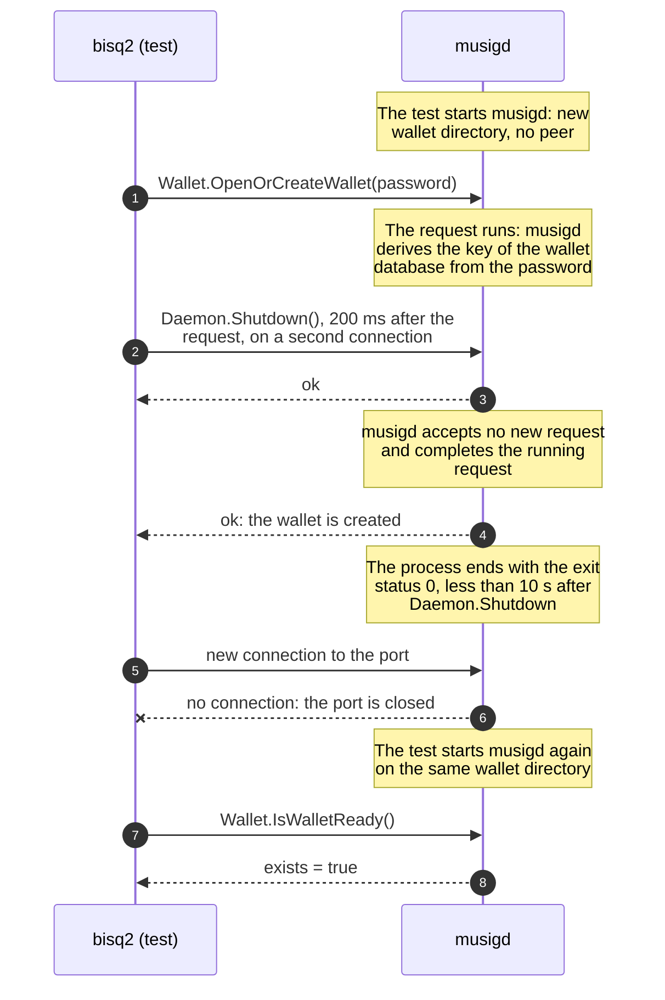

## 12. `musigd_ends_an_open_subscription_when_it_shuts_down`

The regular shutdown with a client that keeps a subscription open. The process ends the stream of
the subscription when it is asked to shut down, and does not wait for the client.

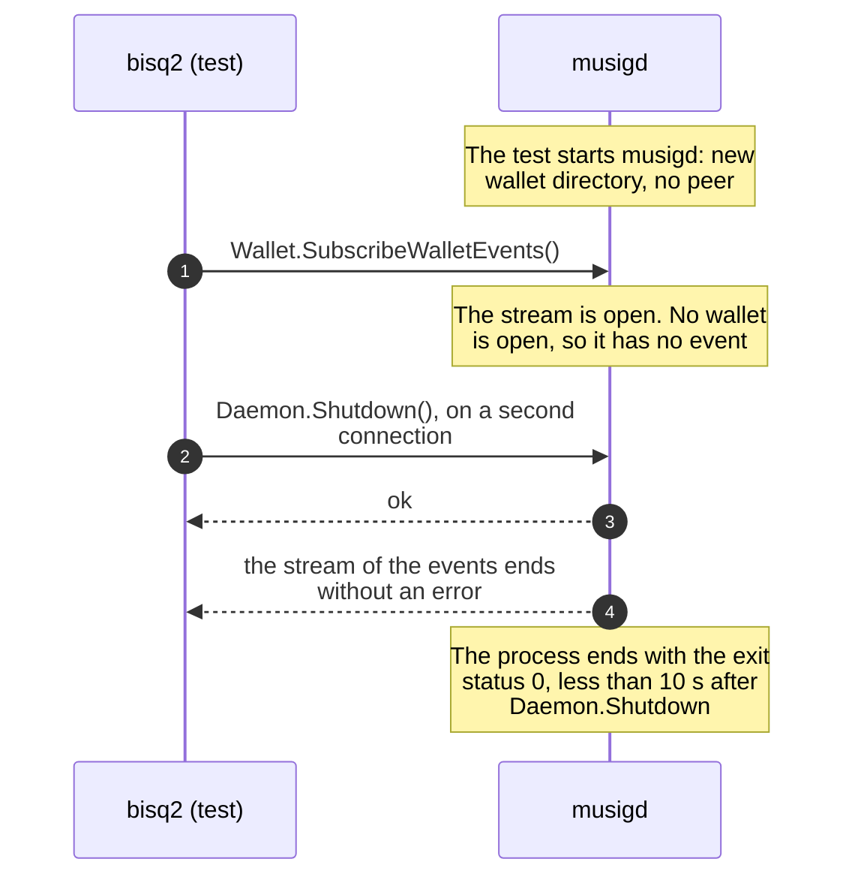

## 13. `musigd_shuts_down_at_the_limit_while_a_request_is_open`

The regular shutdown with a client that does not complete a request. The process waits for the
request up to the limit of 10 seconds, then ends it, and still ends with the exit status 0.

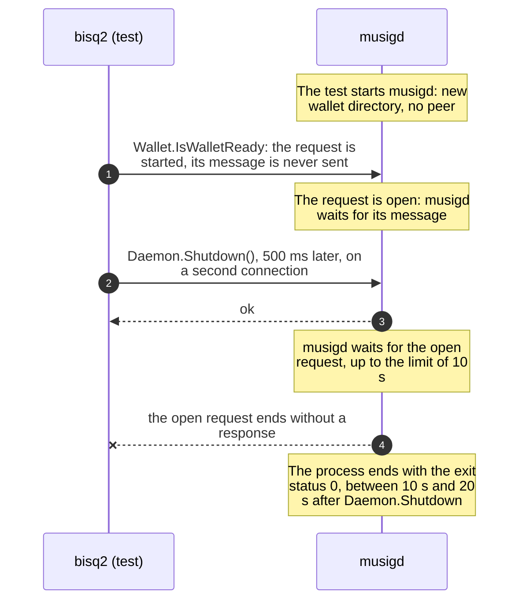

## 14. `musigd_shuts_down_on_a_termination_signal`

The signals SIGTERM and SIGINT are the second way to ask for the regular shutdown. The process ends
an open subscription and ends with the exit status 0, as after the request `Shutdown`.

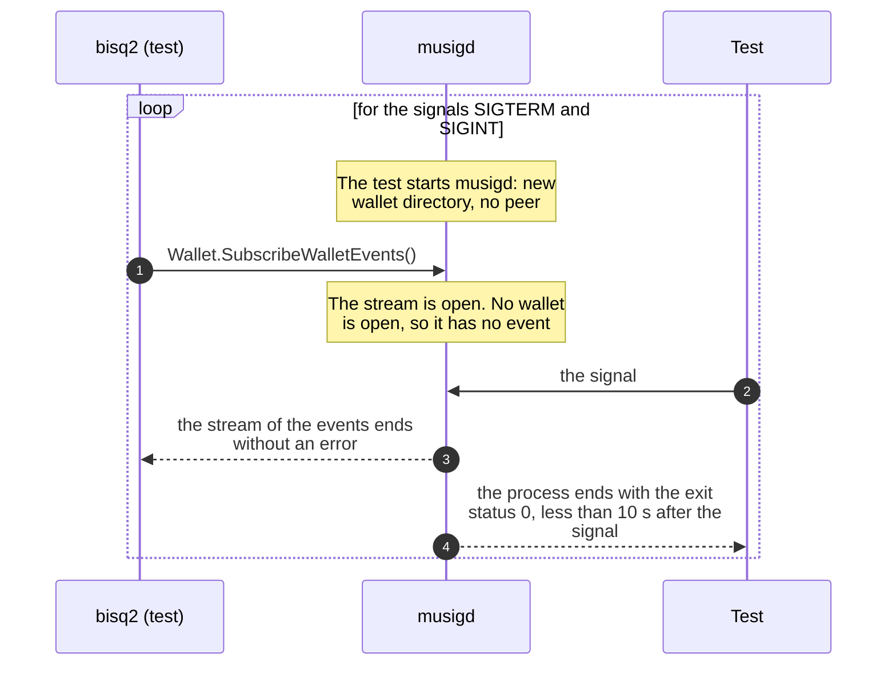
